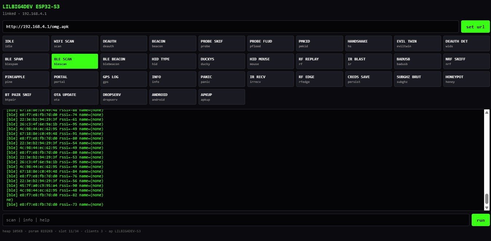

# esp32s3_kit - LILBIG4DEV ESP32-S3

A 35-slot offensive toolkit for the ESP32-S3. Wi-Fi recon and injection, BLE spam/scan/beacon, HID keyboard + mouse + DuckyScript, IR blast/recv, RF stubs, captive-portal delivery, pure-HID Android dropper, and an HTTP upload slot to push large payloads directly into LittleFS.



## Hardware
- MCU: ESP32-S3 (QFN56 rev v0.2), dual-core @ 240 MHz, 8 MB PSRAM
- Flash: 8 MB
- Display: ST7789 TFT (135x240) via SPI
- USB: Native USB-Serial/JTAG

### Pin Map
BTN_PIN 0 (short = next, long >=800ms = prev)
LED_PIN 48
TFT_CS 10 / TFT_DC 9 / TFT_RST 8 / TFT_BL 7
IR_TX_PIN 4 / IR_RX_PIN 5
CC1101_CS 21 / NRF24_CS 14
GPS_RX 16 / GPS_TX 17 (UART2)

## Setup Guide (Arduino IDE)

### 1. Required Libraries
You MUST install these 5 libraries via Sketch -> Include Library -> Manage Libraries:
1. Adafruit GFX Library
2. Adafruit ST7735 and ST7789 Library
3. Adafruit BusIO
4. ArduinoJson
5. IRremoteESP8266

(Note: WiFi, BLEDevice, USBHID, WebServer, DNSServer, and LittleFS are built into the ESP32 core. Do not install separate copies.)

### 2. Select the Board
Go to Tools and set exactly these parameters:
- Board: ESP32S3 Dev Module
- USB CDC On Boot: Enabled
- CPU Frequency: 240MHz
- Flash Mode: QIO 80MHz
- Flash Size: 8MB (64Mb)
- Partition Scheme: Custom (Requires partitions.csv in the sketch folder)
- PSRAM: OPI PSRAM
- Upload Speed: 921600

### 3. The Custom Partition
To fit a 3.5MB APK in the filesystem alongside the 1.4MB firmware, this repo uses a custom partition table. Ensure partitions.csv is in the same folder as esp32s3_kit.ino:

```csv
# Name,   Type, SubType, Offset,   Size,     Flags
nvs,      data, nvs,     0x9000,   0x5000,
otadata,  data, ota,     0xe000,   0x2000,
app0,     app,  ota_0,   0x10000,  0x3C0000,
spiffs,   data, spiffs,  0x3D0000, 0x420000,